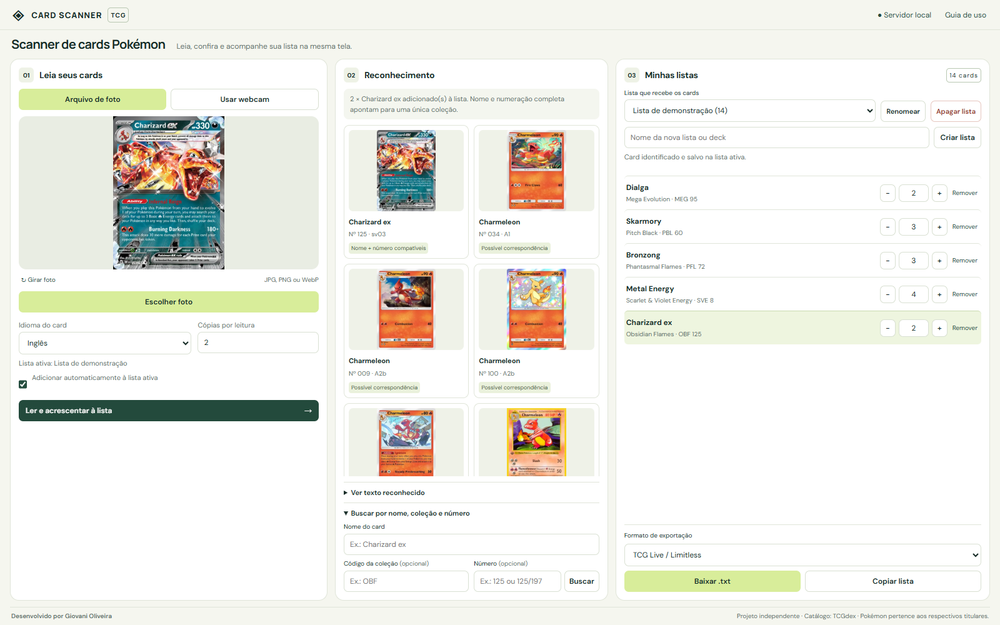
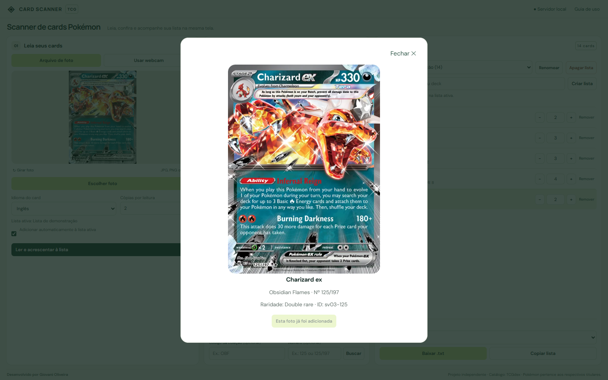
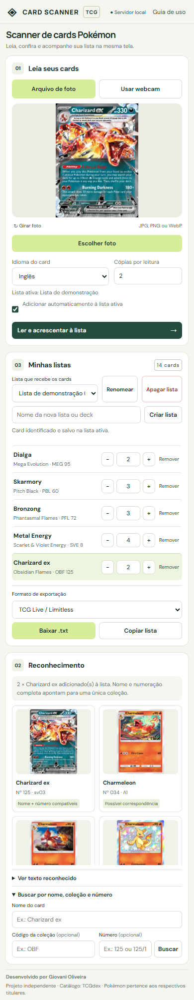

# Card Scanner TCG

**Da carta física à sua lista.** Leia, confira e organize seus cards Pokémon em uma única tela.



<p align="center"><strong>Foto e webcam · OCR local · Português e inglês · Múltiplas listas · Exportação TCG Live, Limitless e Liga Pokémon</strong></p>

**Desenvolvido por Giovani Oliveira.** Código disponível em [xovani/TCG-Scanner](https://github.com/xovani/TCG-Scanner).

Aplicativo Python para ler cards Pokémon por arquivo de foto ou webcam, inclusive uma câmera de celular disponibilizada pelo Windows como webcam. O computador executa o servidor e o OCR. Por padrão, o acesso acontece somente no próprio computador, sem precisar liberar conexões de entrada no firewall.

## Conheça o aplicativo

| Capturar | Conferir | Organizar e exportar |
| --- | --- | --- |
| Escolha uma foto ou use uma webcam, com captura única ou leitura contínua. | O OCR cruza nome, número e coleção; edições ambíguas aguardam sua confirmação. | Crie listas, ajuste as quantidades e baixe ou copie o texto no formato escolhido. |



<details>
<summary><strong>Veja a interface em uma janela estreita</strong></summary>

<p align="center"></p>

</details>

*Capturas reais do aplicativo com uma lista de demonstração separada das listas do usuário. O OCR foi executado sobre uma imagem de catálogo de Charizard ex OBF 125; isso não mede a precisão em fotografias ou webcams físicas. Imagens de referência: TCGdex.*

**Comece por:** [instalação](#começar-no-windows) · [webcam](#webcam-e-leitura-contínua) · [listas e exportação](#listas-e-exportação-tcg-live--limitless-e-liga-pokémon) · [problemas comuns](#problemas-comuns).

## Tela de trabalho e autoria

No computador, a interface usa três colunas na mesma tela: captura, reconhecimento e lista ativa. O título foi reduzido e o rodapé mostra **Desenvolvido por Giovani Oliveira**. Os controles principais e a exportação permanecem visíveis nas resoluções de desktop verificadas (1280×720, 1366×768 e 1920×1080), com zoom padrão do navegador.

Listas e resultados extensos têm rolagem dentro de seus próprios painéis, mantendo a câmera e os botões de exportação no lugar. O último card adicionado recebe destaque e é trazido para a área visível da lista. As opções de intervalo, proteção de repetição e som ficam em **Opções da leitura e som**; instruções e ajuda ficam em **Guia de uso** no cabeçalho. Abrir opções adicionais pode exigir rolagem interna do painel de captura em telas baixas.

Em telas estreitas, o layout se adapta e permite rolagem da página; no celular, a lista aparece logo após a captura.

Backups locais de versões anteriores não fazem parte da distribuição pública. Suas listas ficam separadas do código, no banco descrito abaixo.

## Começar no Windows

Requer Windows, navegador e Python de 64 bits (**3.11 a 3.13**). As dependências foram instaladas e verificadas com Python 3.13 neste projeto. Você não precisa de Firebase, conta de serviço ou token do GitHub para executar o aplicativo. A primeira preparação do OCR e as consultas ao catálogo exigem internet.

1. Instale o Python e confirme `python --version` em um novo terminal. No GitHub, clique em **Code → Download ZIP**, extraia todos os arquivos e abra a pasta extraída. Na primeira instalação, execute `instalar.bat` e aguarde a conclusão.
2. Abra `iniciar.bat` e mantenha o terminal aberto.
3. No computador, acesse `http://127.0.0.1:5000`.
4. Fotografe o card no celular e transfira a imagem ao computador por um meio permitido pela empresa.
5. Clique em **Escolher foto**, abra a imagem e clique em **Ler e acrescentar à lista**.
6. A edição identificada por nome, número e coleção é acrescentada à lista ativa. Quando houver dúvida, abra um candidato e use **Adicionar à lista**.

Como alternativa aos passos 4 e 5, escolha **Usar webcam** para captura única ou leitura contínua.

Na primeira abertura, o aplicativo prepara **Minha lista**. Se quiser outro destino, crie uma lista em **Minhas listas** antes de escanear. Selecione o idioma da carta e a quantidade em **Cópias por leitura**; confira a edição sugerida e as quantidades antes de exportar.

Para encerrar, pressione **Ctrl+C** no terminal do servidor. Nos próximos usos, basta executar `iniciar.bat`. Para atualizar uma instalação, feche o aplicativo e preserve `data/lists.sqlite3`: esse arquivo contém suas listas e não vem no pacote do GitHub.

## Listas e exportação TCG Live / Limitless e Liga Pokémon

- A seção **Minhas listas** permite criar e renomear várias listas ou decks. O seletor **Lista que recebe os cards** determina o destino das próximas leituras. A primeira abertura cria **Minha lista**; a última lista escolhida é lembrada nesse navegador.
- **Apagar lista**, ao lado de **Renomear**, pede confirmação com o nome e a quantidade de cards. Ao confirmar, remove permanentemente a lista selecionada e seus itens, mantendo as demais listas. O aplicativo seleciona outra lista disponível; se você apagar a última, cria uma nova **Minha lista** vazia. O botão fica desabilitado enquanto uma leitura ou outra operação estiver em andamento.
- Antes da leitura, escolha **Cópias por leitura** (padrão: 1). Uma nova foto da mesma edição soma essa quantidade ao item existente.
- **Adicionar automaticamente** vem ativado. O aplicativo cruza o nome no topo, o número do card e o código da coleção no rodapé. Se não houver código legível, a fração completa (por exemplo, `125/197`) pode identificar uma única coleção. Quando existir ambiguidade, conflito ou falha na consulta, o aplicativo aguarda a escolha manual.
- Promos com código e numeração sem fração, como `SVP PT 001`, também podem ser identificadas. A qualidade do OCR continua dependendo da foto.
- Repetir **Ler** na mesma foto e lista não adiciona novamente. Para mais cópias dessa foto, use **+** na lista. Selecionar o arquivo novamente inicia uma nova leitura. A proteção também evita duplicação se uma requisição de inclusão for repetida.
- Para escolher manualmente, abra um candidato e clique em **Adicionar à lista**. A busca aceita nome, número e código de coleção (por exemplo, `Charizard ex`, `125`, `OBF`). Ao informar coleção na busca, informe também o número.
- Você pode digitar a quantidade de cada card na lista e pressionar **Enter** ou sair do campo para salvar. São aceitos inteiros de **0 a 999**; zero remove o card. **Esc** cancela a alteração ainda não salva. Os botões **+**, **−** e **Remover** continuam disponíveis e mantêm a posição da rolagem ao editar, sem deslocar a lista para o último card escaneado. A inclusão de novos cards durante o escaneamento continua trazendo o item adicionado para a área visível. As quantidades permitem listas de coleção e decks em construção; não impõem o limite de quatro cópias ou 60 cards.
- Escolha **TCG Live / Limitless** ou **Liga Pokémon (procura de cartas)** e use **Baixar .txt** ou **Copiar lista**. TCG Live / Limitless compartilham uma única opção com seções Pokémon, Trainer e Energy e total de cards. O Limitless aceita o texto do Live, conforme sua [documentação](https://docs.limitlesstcg.com/player/decklists.html).
- O formato **Liga Pokémon** segue o padrão informado para procura de cartas: `4 Dragapult ex (130/167)`, uma linha por edição, sem cabeçalhos, total da lista ou código da coleção. Usa nomes em inglês e o total oficial impresso da coleção; uma carta secreta pode aparecer como `223/197`. Coleções identificadas pelo catálogo como promocionais usam `∞` no denominador e preservam a numeração original, inclusive zeros iniciais: `4 Binacle (087/∞)`. Mesmo que o catálogo cadastre um total para a coleção promocional, a exportação Liga usa infinito. Listas antigas recebem esses dados na próxima exportação, usando o catálogo ou cache e preservando as quantidades. Para coleções comuns sem numeração completa no catálogo, a exportação informa o problema e preserva a lista.
- Na exportação **Liga Pokémon**, os números inteiramente numéricos da carta e do total da coleção têm pelo menos três dígitos: `1 Mienfoo (052/086)` e `1 Jett (079/084)`. A regra vale também para listas antigas; zeros já presentes e prefixos como `TG` são preservados, e os promocionais continuam usando `∞` no denominador.
- O formato **TCG Live / Limitless** usa nomes em inglês, códigos `tcgOnline` ou a abreviação oficial da coleção e números sem zeros iniciais quando inteiramente numéricos. Prefixos de numeração, como `TG`, são preservados. Energias básicas são exportadas com símbolos, como `Basic {L} Energy`. Configure o importador do TCG Live em inglês para esses arquivos. A opção Liga Pokémon usa o nome comum da energia, sem essa conversão em símbolos.
- Caso o catálogo não informe o nome em inglês, a categoria ou o código de uma edição, a exportação TCG Live / Limitless informa o problema em vez de inventar dados. Liga Pokémon exige nome e numeração completa, sem depender do código ou da categoria. A inclusão exige consultar os detalhes do card e da coleção, disponíveis também em cache após o primeiro uso.
- Gerar o arquivo não comprova que o deck seja válido no formato escolhido ou que todas as edições existam no TCG Live. Essa validação é feita no jogo ou torneio. O aplicativo não envia listas a serviços externos.

As listas ficam no arquivo `data/lists.sqlite3`, separadas do cache do catálogo. Feche o aplicativo e copie esse arquivo para fazer backup. Não apague a pasta `data/` para limpar o cache sem preservar esse banco.

Exemplo de exportação Live:

```text
Pokémon: 1
2 Charizard ex OBF 125

Total Cards: 2
```

O modo padrão escuta apenas em `127.0.0.1`, sem aceitar conexões do celular ou de outros computadores. Não é necessário alterar o firewall para esse fluxo. As consultas externas ao catálogo e às imagens continuam dependendo de acesso à internet permitido pela rede; políticas que bloqueiem a execução do Python também continuam se aplicando.

## Webcam e leitura contínua

1. Abra o aplicativo no computador por `http://127.0.0.1:5000` ou `http://localhost:5000` e selecione a lista ativa.
2. Escolha **Usar webcam** e clique em **Ativar webcam**. Autorize o acesso no navegador. O aplicativo solicita somente vídeo, sem microfone.
3. O seletor **Webcam do computador** lista todas as entradas de vídeo que o navegador tiver permissão para acessar. Selecione a câmera integrada, USB ou virtual desejada. Ao trocar, a câmera anterior é liberada. Use **Atualizar** se conectar uma nova câmera.
4. Posicione o card inteiro na moldura, com o nome em cima e o número do rodapé visível. Só a área dentro da moldura é enviada ao OCR.
5. Use **Capturar e ler uma vez** ou **Iniciar leitura contínua**. O modo contínuo ativa a inclusão automática na lista selecionada e usa a quantidade em **Cópias por leitura**.
6. Ao confirmar a edição e salvar o card na lista, o aplicativo emite um bip. A pausa padrão é de **2,5 segundos**, com opções de **2** e **3 segundos**. Depois da pausa, faz outra captura. Cada leitura termina antes da próxima começar; o tempo do OCR e das consultas é adicional à pausa.
7. Clique em **Parar** para encerrar o ciclo mantendo a prévia, ou **Desligar** para liberar a câmera. Voltar a **Arquivo de foto** também desliga a webcam. A leitura contínua pausa ao sair da aba.

**Evitar contar novamente o mesmo card parado** vem ativado. Nesse modo, uma edição já salva não é somada novamente enquanto continuar sendo identificada na câmera. Trocar por uma edição diferente permite a próxima inclusão imediatamente no próximo ciclo. Para outra cópia da mesma edição, retire o card e aguarde **Área livre** (duas leituras sem texto) antes de apresentá-la. Se preferir somar a cada ciclo, mesmo sem trocar o card, desmarque essa proteção antes de iniciar. A verificação depende do OCR; texto ilegível não é uma detecção visual garantida de área vazia.

O bip só ocorre após uma nova inclusão confirmada; não toca quando a edição estiver ambígua ou tiver sido ignorada pela proteção. Use **Testar bip** e ajuste o volume do computador se necessário. A opção de som pode ser desativada. Ao ocorrer uma falha de conexão ou de inclusão, o ciclo pausa para conferência da lista.

Se você parar durante o reconhecimento, esse resultado não inicia uma nova inclusão. Uma inclusão que já tiver sido enviada pode terminar e aparecer na lista; nenhuma nova captura será agendada. A lista, o idioma e as quantidades ficam travados enquanto o ciclo estiver ativo: pare para alterá-los.

### Câmera do celular pelo Windows

Habilite a câmera conectada no próprio Windows: **Configurações → Bluetooth e dispositivos → Dispositivos móveis → Gerenciar dispositivos → Usar como câmera conectada**. A Microsoft documenta esse recurso para Windows 11 e Android compatível; confira os requisitos no [suporte oficial](https://support.microsoft.com/pt-br/windows/apps/phonelink/use-your-mobile-device-s-camera). Depois de vinculada e autorizada, ela poderá aparecer no seletor do aplicativo como outra webcam. A configuração e as permissões do recurso do Windows continuam sendo necessárias.

O acesso a webcams pelo navegador exige um contexto seguro. `localhost` e `127.0.0.1` são apropriados para uso no próprio computador; abrir por um IP de rede em HTTP não libera essa API. Nesse caso, mantenha a leitura por arquivo ou use HTTPS. A lista de câmeras depende das permissões do sistema e do navegador, conforme a [documentação de enumerateDevices](https://developer.mozilla.org/en-US/docs/Web/API/MediaDevices/enumerateDevices). O aplicativo não pode disponibilizar uma câmera bloqueada pelo Windows.

## Câmera diretamente no celular (rede autorizada)

Em uma rede que permita conexões entre os dispositivos, execute:

```powershell
.\.venv\Scripts\python.exe app.py --rede
```

Nesse modo, computador e celular precisam estar na mesma rede Wi-Fi. A tela oferece **Abrir no celular** com QR code e o terminal mostra o endereço de acesso. No celular, toque em **Fotografar card** e depois em **Ler e identificar card**. O seletor depende do navegador; se a câmera não for oferecida, use **Escolher foto**.

Esse modo continua dependendo das permissões da rede e do firewall. Para usar a câmera diretamente sem conexões de entrada neste computador, uma alternativa é hospedar o servidor Python com HTTPS em infraestrutura aprovada. Essa hospedagem não está configurada neste projeto e mudaria o local de processamento das fotos para o servidor remoto.

## Problemas comuns

| Situação | O que conferir |
| --- | --- |
| `python` não foi encontrado | Instale Python 3.11 a 3.13 de 64 bits e confirme `python --version` em um novo terminal. |
| A página não abre | Mantenha `iniciar.bat` em execução e abra `http://127.0.0.1:5000` no mesmo computador. Confira mensagens no terminal e se você alterou a porta. |
| A primeira leitura demora | O OCR pode precisar preparar e baixar os modelos. Aguarde a conclusão e confira o acesso à internet. |
| O card não foi reconhecido | Selecione o idioma correto, enquadre nome e rodapé, evite reflexos e tente a busca manual por nome, número e coleção. Confira os candidatos antes de adicionar. |
| A webcam não aparece | Autorize a câmera no Windows e no navegador, clique em **Atualizar** e confira se outro programa está usando o dispositivo. O celular precisa estar disponibilizado como câmera pelo Windows. |
| O mesmo card parado não é somado novamente | A proteção contra repetição está ativada. Retire o card e aguarde **Área livre**, ajuste a quantidade na lista ou desative a proteção antes de iniciar o ciclo. |
| A exportação acusa dados ausentes | Confira o acesso ao catálogo e a identificação da edição. O aplicativo informa dados incompletos em vez de inventar o nome ou a coleção. |

## Comandos

```powershell
python -m venv .venv
.\.venv\Scripts\python.exe -m pip install -r requirements.txt
.\.venv\Scripts\python.exe app.py
```

Para outra porta, defina `$env:PORT = '5050'` antes de iniciar. Encerre com `Ctrl+C`.

## Como funciona

- Flask recebe a foto e serve a interface responsiva em HTML, CSS e JavaScript.
- O navegador reduz a imagem antes de enviá-la ao servidor local. Pillow corrige a orientação EXIF e o RapidOCR/ONNX Runtime extrai o texto no computador, usando CPU.
- RapidFuzz compara os nomes reconhecidos na região superior com o catálogo TCGdex. O número do rodapé, quando lido no formato `025/165`, ajuda a ordenar as edições.
- A busca manual aceita nome, número e código da coleção, no idioma selecionado.
- O catálogo é salvo em `data/`, com atualização após sete dias e fallback para o cache quando o serviço estiver indisponível. Consultas recentes também ficam na memória.
- As fotos ficam somente na memória durante a leitura; não são gravadas nem enviadas ao TCGdex. O navegador consulta imagens de referência do catálogo. O RapidOCR pode baixar seus modelos no primeiro uso, que exige internet; consultas de detalhes e imagens também usam internet.
- A tela exibe até 12 candidatos. O reconhecimento automático considera todos os candidatos compatíveis antes desse limite; sugestões e inclusões devem ser conferidas, pois o OCR pode errar.

## Limites desta primeira versão

Fotografe apenas um card, de frente, na posição vertical, preenchendo a foto e sem cortar as bordas. Reflexos em cards holográficos, capas, desfoque e letras muito pequenas prejudicam o OCR. Use o botão de girar para arquivos quando necessário. Na webcam, ajuste a orientação do dispositivo ou do Windows para deixar o card na vertical. O modo contínuo processa capturas periódicas do vídeo; não faz reconhecimento visual da arte nem correção de perspectiva.

Idiomas disponíveis: português e inglês. A cobertura depende do catálogo externo e pode variar entre idiomas e edições. O texto reconhecido continua disponível se o catálogo falhar. Cards com o mesmo nome e número em coleções diferentes precisam ser diferenciados pela imagem e pelos detalhes. Acabamento holográfico, autenticidade, estado de conservação e preços não são avaliados.

No modo `--rede`, o botão de câmera usa um campo de arquivo com `capture="environment"`, permitindo o fluxo de foto em navegadores móveis sem depender de vídeo via `getUserMedia`, que exige contexto seguro. Não há aplicativo Android/iOS nativo nesta versão. Publicação com HTTPS e acesso fora do Wi-Fi é uma etapa separada.

## Verificação

Testes automatizados sem internet:

```powershell
.\.venv\Scripts\python.exe -m unittest discover -s tests -v
```

Integração real, com internet e OCR (baixa catálogo e uma imagem de referência, sem salvar a foto):

```powershell
.\.venv\Scripts\python.exe scripts/check_live.py
```

O teste de integração também lê uma imagem moderna, adiciona automaticamente a edição à lista temporária e confere a exportação. Esses testes não substituem testar a câmera física e a rede do celular e não medem precisão em fotos reais. Não foi feita uma importação autenticada dentro do jogo ou de um torneio.

Teste opcional da interface, usando Google Chrome já instalado e um banco temporário:

```powershell
.\.venv\Scripts\python.exe -m pip install -r requirements-dev.txt
.\.venv\Scripts\python.exe scripts/check_browser.py
```

Esse teste usa OCR, catálogo e webcams simulados para verificar botões, múltiplas listas, persistência, download, quantidades, layout móvel, seleção/troca/liberação de câmeras, intervalo dos ciclos, bipes, proteção de repetição, parada durante OCR e erro de permissão. Não baixa nem instala navegador, não acessa suas câmeras físicas e não altera suas listas. A integração com o celular vinculado ao Windows precisa ser conferida no equipamento real.

## Referências

- [RapidOCR: instalação e uso](https://rapidai.github.io/RapidOCRDocs/main/en/install_usage/rapidocr/usage/)
- [TCGdex: catálogo de cards](https://tcgdex.dev/rest/cards)
- [TCGdex: detalhes de um card](https://tcgdex.dev/rest/card)

Projeto independente, sem afiliação à Pokémon. Os cards e marcas pertencem aos respectivos titulares; os dados e imagens vêm do TCGdex. Consulte as licenças dos fornecedores antes de redistribuir modelos ou dados.
